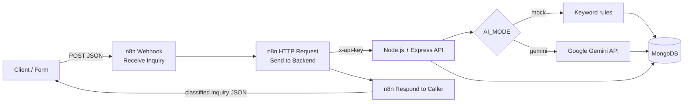
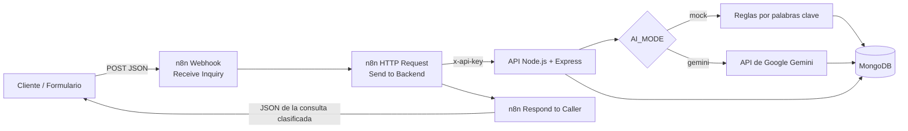

# Smart Inquiry Triage API

🇬🇧 [English](#-english) · 🇦🇷 [Español](#-español)

---

# 🇬🇧 English

## Overview

**Smart Inquiry Triage API** receives customer inquiries (web forms, WhatsApp, email), classifies them automatically, stores them, and returns a result that a support team can act on.

For every inquiry the system produces:

- a **category** (`ventas`, `soporte`, `facturacion`, `reclamo`, `otro`),
- an **urgency level** (`baja`, `media`, `alta`),
- a **one-line summary**,
- a **suggested reply** addressed to the customer by name.

An **n8n** workflow exposes a public webhook, forwards each inquiry to the Node.js backend, and returns the classified result to the caller. The classifier runs in two modes: a free keyword-based **mock** mode (default, no internet or API key needed) and a **Google Gemini** mode.

## How it works



1. A client sends `POST /webhook/smart-inquiry-triage` to n8n.
2. n8n forwards the body to `POST /api/consultas` on the backend, with the `x-api-key` header.
3. The backend validates the data, saves the inquiry, classifies it, and updates its status.
4. n8n returns the backend response to the original caller.

**Idempotency:** each inquiry has a unique `externalId`. Re-sending the same `externalId` never creates a duplicate; the stored inquiry is returned (and the classification is retried only if the previous attempt ended in `error`).

## Tech stack

| Area | Technology |
|---|---|
| Runtime | Node.js 22 |
| Web framework | Express 5 |
| Database | MongoDB 7 + Mongoose 9 |
| Automation | n8n (self-hosted, Docker) |
| AI classification | Keyword rules (mock) or Google Gemini API (free tier, Google AI Studio) |
| Containers | Docker, Docker Compose |
| Testing | Jest 30 + Supertest |
| Config | dotenv |
| Dev tools | nodemon |

## Project structure

```
smart-inquiry-triage/
├── src/
│   ├── app.js                      # Express app (no listen, so tests can import it)
│   ├── server.js                   # Entry point: connects to MongoDB and starts the server
│   ├── config/
│   │   ├── constantes.js           # Allowed values (channels, statuses, categories, urgencies)
│   │   ├── db.js                   # MongoDB connection
│   │   └── env.js                  # Loads and validates environment variables
│   ├── controllers/
│   │   └── consultas.controller.js # Endpoint logic (create, list, get, update status)
│   ├── middlewares/
│   │   ├── apiKey.js               # Requires the x-api-key header (401 otherwise)
│   │   ├── errorHandler.js         # 404 and global error handling
│   │   └── validate.js             # Input validation (400 with details)
│   ├── models/
│   │   └── Consulta.js             # Mongoose model for inquiries
│   ├── routes/
│   │   ├── consultas.routes.js     # /api/consultas
│   │   └── health.routes.js        # /api/health
│   └── services/
│       └── ai.service.js           # Classifier: mock rules or Gemini, with retries
├── tests/
│   ├── consultas.test.js           # API endpoint tests
│   ├── ai.mock.test.js             # Mock classifier tests
│   └── ai.gemini.test.js           # Gemini classifier tests
├── n8n/
│   ├── README.md                   # How to import and use the workflow
│   ├── workflows/
│   │   └── smart-inquiry-triage.json   # Exported n8n workflow (no real API key)
│   └── examples/
│       └── webhook-payload.json    # Example request body
├── docs/
│   └── etapa-1-diseno.md           # Stage 1 design: data model and endpoints (Spanish)
├── Dockerfile                      # API image (node:22-bookworm-slim)
├── docker-compose.yml              # Runs the API container
├── .dockerignore
├── .env.example                    # Environment variable template
├── .gitignore
├── package.json
└── README.md
```

## API reference

All `/api/consultas` routes require the header `x-api-key: <API_KEY>`. `/api/health` does not.

| Method | Route | Description |
|---|---|---|
| `GET` | `/api/health` | Checks that the API and MongoDB are up |
| `POST` | `/api/consultas` | Saves and classifies an inquiry. `201` new, `200` already existed, `502` if classification failed |
| `GET` | `/api/consultas` | Lists inquiries. Filters: `estado`, `urgencia`, `categoria`, `limit` (max 100) |
| `GET` | `/api/consultas/:id` | Gets one inquiry |
| `PATCH` | `/api/consultas/:id` | Updates the status: `{ "estado": "notificada" }` |

**Request body for `POST /api/consultas`:**

```json
{
  "externalId": "web-0001",
  "nombre": "Ana Perez",
  "email": "ana@ejemplo.com",
  "canal": "web",
  "mensaje": "Me cobraron dos veces el mes pasado y necesito el reembolso."
}
```

**Response:**

```json
{
  "externalId": "web-0001",
  "nombre": "Ana Perez",
  "email": "ana@ejemplo.com",
  "canal": "web",
  "mensaje": "Me cobraron dos veces el mes pasado y necesito el reembolso.",
  "estado": "clasificada",
  "clasificacion": {
    "categoria": "facturacion",
    "urgencia": "media",
    "resumen": "[facturacion] Me cobraron dos veces el mes pasado y necesito el reembolso",
    "respuestaSugerida": "Hola Ana Perez, lamentamos el inconveniente. Ya estamos revisando tu caso de facturación y te confirmamos a la brevedad."
  },
  "id": "6af12ef11d2fae4ea8d88f15"
}
```

**Allowed values**

- `canal`: `web`, `whatsapp`, `email`, `formulario`
- `estado`: `pendiente`, `clasificada`, `notificada`, `error`
- `categoria`: `ventas`, `soporte`, `facturacion`, `reclamo`, `otro`
- `urgencia`: `baja`, `media`, `alta`
- Limits: `mensaje` up to 2000 characters, `nombre` up to 100, request body up to 10 KB.

## Environment variables

Copy `.env.example` to `.env` and adjust it. **Never commit `.env`.**

| Variable | Required | Description |
|---|---|---|
| `PORT` | No | API port (the example uses `3100`) |
| `MONGO_URI` | Yes | MongoDB connection string |
| `API_KEY` | Yes | Key that clients (n8n) must send in `x-api-key` |
| `AI_MODE` | No | `mock` (default) or `gemini` |
| `GEMINI_API_KEY` | Only with `gemini` | Google AI Studio API key |
| `GEMINI_MODEL` | Only with `gemini` | Gemini model name |
| `GEMINI_RETRY_MS` | No | Base wait between Gemini retries (ms) |

## Getting started

### 1. Install and run MongoDB

```bash
docker run -d --name triage-mongo -p 27018:27017 mongo:7
```

### 2. Run the API

**Locally:**

```bash
npm install
cp .env.example .env      # on Windows: copy .env.example .env
npm start                 # or: npm run dev
```

**With Docker Compose** (the container reaches MongoDB through `host.docker.internal`):

```bash
docker compose up -d --build
```

Check it: `http://localhost:3100/api/health`

### 3. Run n8n

```bash
docker run -d --name triage-n8n -p 5678:5678 -v n8n_data:/home/node/.n8n docker.n8n.io/n8nio/n8n
```

Then import `n8n/workflows/smart-inquiry-triage.json`, set your `API_KEY` in the **Send to Backend** node, and publish the workflow. See [`n8n/README.md`](n8n/README.md).

### 4. Send a test inquiry

```bash
curl -X POST http://localhost:5678/webhook/smart-inquiry-triage \
  -H "Content-Type: application/json" \
  -d '{"externalId":"demo-001","nombre":"Ana Perez","email":"ana@ejemplo.com","canal":"web","mensaje":"Me cobraron dos veces y necesito que me devuelvan el dinero."}'
```

Use a new `externalId` for each test.

## n8n workflow

Three nodes:

1. **Receive Inquiry** — Webhook (`POST`, path `smart-inquiry-triage`, responds via node).
2. **Send to Backend** — HTTP Request to `http://host.docker.internal:3100/api/consultas`, with the `x-api-key` header and body `{{ JSON.stringify($json.body) }}`.
3. **Respond to Caller** — Respond to Webhook, returns the backend JSON.

Use the **Test URL** (`/webhook-test/...`) while editing and the **Production URL** (`/webhook/...`) once the workflow is published.

## Tests

```bash
npm test
```

Jest + Supertest. The tests cover the endpoints, validation, API key protection, idempotency, and both classifier modes.

## Security notes

- API key required on all inquiry routes, compared with `crypto.timingSafeEqual`.
- Input validation on every route and a 10 KB body limit.
- The AI response is validated before saving; the customer text is treated as data, not as instructions.
- `.env` is git-ignored and excluded from the Docker image. The exported n8n workflow uses the placeholder `REEMPLAZAR_CON_API_KEY` instead of a real key.

## Roadmap

Not implemented yet:

- Telegram notifications routed by urgency (n8n).
- Dedicated error branches in the n8n workflow.
- Continuous integration (GitHub Actions).

---

# 🇦🇷 Español

## Descripción

**Smart Inquiry Triage API** recibe consultas de clientes (formularios web, WhatsApp, email), las clasifica automáticamente, las guarda y devuelve un resultado listo para que un equipo de atención actúe.

Para cada consulta el sistema genera:

- una **categoría** (`ventas`, `soporte`, `facturacion`, `reclamo`, `otro`),
- un **nivel de urgencia** (`baja`, `media`, `alta`),
- un **resumen** de una línea,
- una **respuesta sugerida** dirigida al cliente por su nombre.

Un workflow de **n8n** expone un webhook público, reenvía cada consulta al backend en Node.js y devuelve el resultado clasificado a quien llamó. El clasificador funciona en dos modos: un modo **mock** gratuito basado en palabras clave (por defecto, sin internet ni API key) y un modo con **Google Gemini**.

## Cómo funciona



1. Un cliente envía `POST /webhook/smart-inquiry-triage` a n8n.
2. n8n reenvía el body a `POST /api/consultas` del backend, con el header `x-api-key`.
3. El backend valida los datos, guarda la consulta, la clasifica y actualiza su estado.
4. n8n devuelve la respuesta del backend a quien hizo la llamada original.

**Idempotencia:** cada consulta tiene un `externalId` único. Si se reenvía el mismo `externalId`, no se crea un duplicado: se devuelve la consulta guardada (y la clasificación solo se reintenta si el intento anterior terminó en `error`).

## Tecnologías

| Área | Tecnología |
|---|---|
| Entorno de ejecución | Node.js 22 |
| Framework web | Express 5 |
| Base de datos | MongoDB 7 + Mongoose 9 |
| Automatización | n8n (self-hosted, Docker) |
| Clasificación con IA | Reglas por palabras clave (mock) o API de Google Gemini (plan gratuito, Google AI Studio) |
| Contenedores | Docker, Docker Compose |
| Tests | Jest 30 + Supertest |
| Configuración | dotenv |
| Herramientas de desarrollo | nodemon |

## Estructura del proyecto

```
smart-inquiry-triage/
├── src/
│   ├── app.js                      # App de Express (sin listen, para poder importarla en los tests)
│   ├── server.js                   # Punto de entrada: conecta a MongoDB y levanta el servidor
│   ├── config/
│   │   ├── constantes.js           # Valores permitidos (canales, estados, categorías, urgencias)
│   │   ├── db.js                   # Conexión a MongoDB
│   │   └── env.js                  # Carga y valida las variables de entorno
│   ├── controllers/
│   │   └── consultas.controller.js # Lógica de los endpoints (crear, listar, obtener, actualizar estado)
│   ├── middlewares/
│   │   ├── apiKey.js               # Exige el header x-api-key (401 si falta o es incorrecta)
│   │   ├── errorHandler.js         # 404 y manejo global de errores
│   │   └── validate.js             # Validación de entrada (400 con detalle)
│   ├── models/
│   │   └── Consulta.js             # Modelo de Mongoose para las consultas
│   ├── routes/
│   │   ├── consultas.routes.js     # /api/consultas
│   │   └── health.routes.js        # /api/health
│   └── services/
│       └── ai.service.js           # Clasificador: reglas mock o Gemini, con reintentos
├── tests/
│   ├── consultas.test.js           # Tests de los endpoints
│   ├── ai.mock.test.js             # Tests del clasificador mock
│   └── ai.gemini.test.js           # Tests del clasificador Gemini
├── n8n/
│   ├── README.md                   # Cómo importar y usar el workflow
│   ├── workflows/
│   │   └── smart-inquiry-triage.json   # Workflow de n8n exportado (sin API key real)
│   └── examples/
│       └── webhook-payload.json    # Ejemplo de body para probar
├── docs/
│   └── etapa-1-diseno.md           # Diseño de la etapa 1: modelo de datos y endpoints
├── Dockerfile                      # Imagen de la API (node:22-bookworm-slim)
├── docker-compose.yml              # Levanta el contenedor de la API
├── .dockerignore
├── .env.example                    # Plantilla de variables de entorno
├── .gitignore
├── package.json
└── README.md
```

## Referencia de la API

Todas las rutas de `/api/consultas` requieren el header `x-api-key: <API_KEY>`. `/api/health` no lo requiere.

| Método | Ruta | Descripción |
|---|---|---|
| `GET` | `/api/health` | Verifica que la API y MongoDB responden |
| `POST` | `/api/consultas` | Guarda y clasifica una consulta. `201` nueva, `200` ya existía, `502` si falló la clasificación |
| `GET` | `/api/consultas` | Lista consultas. Filtros: `estado`, `urgencia`, `categoria`, `limit` (máx. 100) |
| `GET` | `/api/consultas/:id` | Obtiene una consulta |
| `PATCH` | `/api/consultas/:id` | Actualiza el estado: `{ "estado": "notificada" }` |

**Body de `POST /api/consultas`:**

```json
{
  "externalId": "web-0001",
  "nombre": "Ana Perez",
  "email": "ana@ejemplo.com",
  "canal": "web",
  "mensaje": "Me cobraron dos veces el mes pasado y necesito el reembolso."
}
```

**Respuesta:**

```json
{
  "externalId": "web-0001",
  "nombre": "Ana Perez",
  "email": "ana@ejemplo.com",
  "canal": "web",
  "mensaje": "Me cobraron dos veces el mes pasado y necesito el reembolso.",
  "estado": "clasificada",
  "clasificacion": {
    "categoria": "facturacion",
    "urgencia": "media",
    "resumen": "[facturacion] Me cobraron dos veces el mes pasado y necesito el reembolso",
    "respuestaSugerida": "Hola Ana Perez, lamentamos el inconveniente. Ya estamos revisando tu caso de facturación y te confirmamos a la brevedad."
  },
  "id": "6af12ef11d2fae4ea8d88f15"
}
```

**Valores permitidos**

- `canal`: `web`, `whatsapp`, `email`, `formulario`
- `estado`: `pendiente`, `clasificada`, `notificada`, `error`
- `categoria`: `ventas`, `soporte`, `facturacion`, `reclamo`, `otro`
- `urgencia`: `baja`, `media`, `alta`
- Límites: `mensaje` hasta 2000 caracteres, `nombre` hasta 100, body de hasta 10 KB.

## Variables de entorno

Copiá `.env.example` a `.env` y ajustalo. **Nunca subas `.env` a Git.**

| Variable | Obligatoria | Descripción |
|---|---|---|
| `PORT` | No | Puerto de la API (el ejemplo usa `3100`) |
| `MONGO_URI` | Sí | Cadena de conexión a MongoDB |
| `API_KEY` | Sí | Clave que los clientes (n8n) deben enviar en `x-api-key` |
| `AI_MODE` | No | `mock` (por defecto) o `gemini` |
| `GEMINI_API_KEY` | Solo con `gemini` | API key de Google AI Studio |
| `GEMINI_MODEL` | Solo con `gemini` | Nombre del modelo de Gemini |
| `GEMINI_RETRY_MS` | No | Espera base entre reintentos a Gemini (ms) |

## Primeros pasos

### 1. Levantar MongoDB

```bash
docker run -d --name triage-mongo -p 27018:27017 mongo:7
```

### 2. Ejecutar la API

**En local:**

```bash
npm install
cp .env.example .env      # en Windows: copy .env.example .env
npm start                 # o: npm run dev
```

**Con Docker Compose** (el contenedor llega a MongoDB por `host.docker.internal`):

```bash
docker compose up -d --build
```

Verificá: `http://localhost:3100/api/health`

### 3. Levantar n8n

```bash
docker run -d --name triage-n8n -p 5678:5678 -v n8n_data:/home/node/.n8n docker.n8n.io/n8nio/n8n
```

Después importá `n8n/workflows/smart-inquiry-triage.json`, poné tu `API_KEY` en el nodo **Send to Backend** y publicá el workflow. Ver [`n8n/README.md`](n8n/README.md).

### 4. Enviar una consulta de prueba

```bash
curl -X POST http://localhost:5678/webhook/smart-inquiry-triage \
  -H "Content-Type: application/json" \
  -d '{"externalId":"demo-001","nombre":"Ana Perez","email":"ana@ejemplo.com","canal":"web","mensaje":"Me cobraron dos veces y necesito que me devuelvan el dinero."}'
```

Usá un `externalId` nuevo en cada prueba.

## Workflow de n8n

Tres nodos:

1. **Receive Inquiry** — Webhook (`POST`, path `smart-inquiry-triage`, responde mediante un nodo).
2. **Send to Backend** — HTTP Request a `http://host.docker.internal:3100/api/consultas`, con el header `x-api-key` y body `{{ JSON.stringify($json.body) }}`.
3. **Respond to Caller** — Respond to Webhook, devuelve el JSON del backend.

Usá la **Test URL** (`/webhook-test/...`) mientras editás y la **Production URL** (`/webhook/...`) cuando el workflow está publicado.

## Tests

```bash
npm test
```

Jest + Supertest. Los tests cubren los endpoints, las validaciones, la protección con API key, la idempotencia y los dos modos del clasificador.

## Seguridad

- API key obligatoria en todas las rutas de consultas, comparada con `crypto.timingSafeEqual`.
- Validación de entrada en cada ruta y límite de 10 KB por body.
- La respuesta de la IA se valida antes de guardarse; el texto del cliente se trata como dato, no como instrucciones.
- `.env` está en `.gitignore` y fuera de la imagen de Docker. El workflow de n8n exportado usa el marcador `REEMPLAZAR_CON_API_KEY` en lugar de una clave real.

## Próximos pasos

Todavía no implementado:

- Notificaciones por Telegram según la urgencia (n8n).
- Ramas de error dedicadas en el workflow de n8n.
- Integración continua (GitHub Actions).
